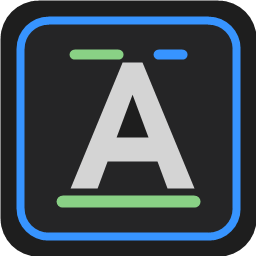
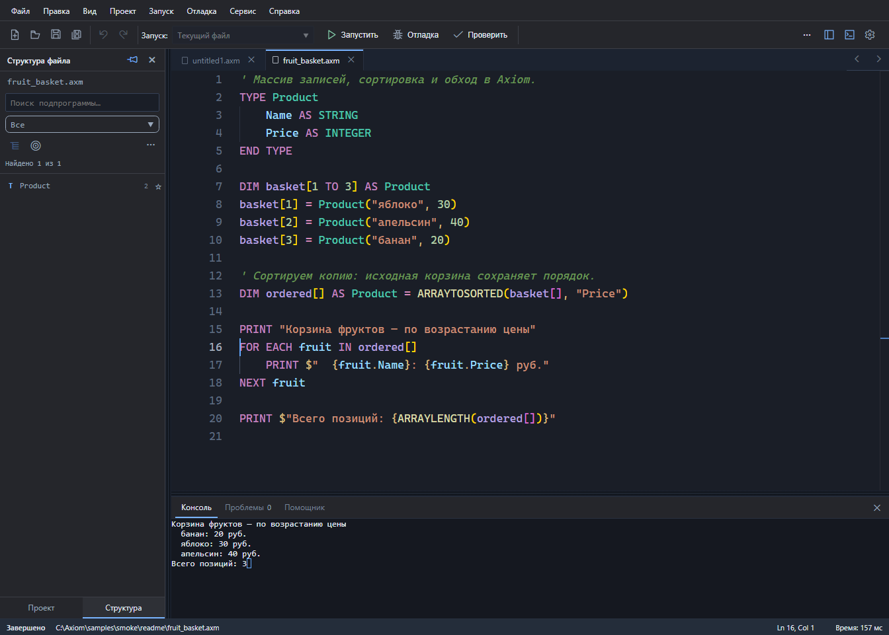
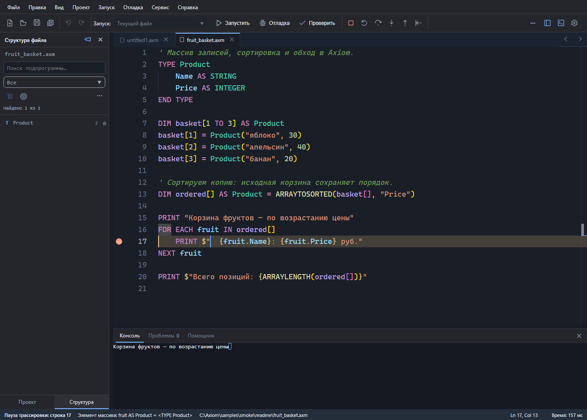
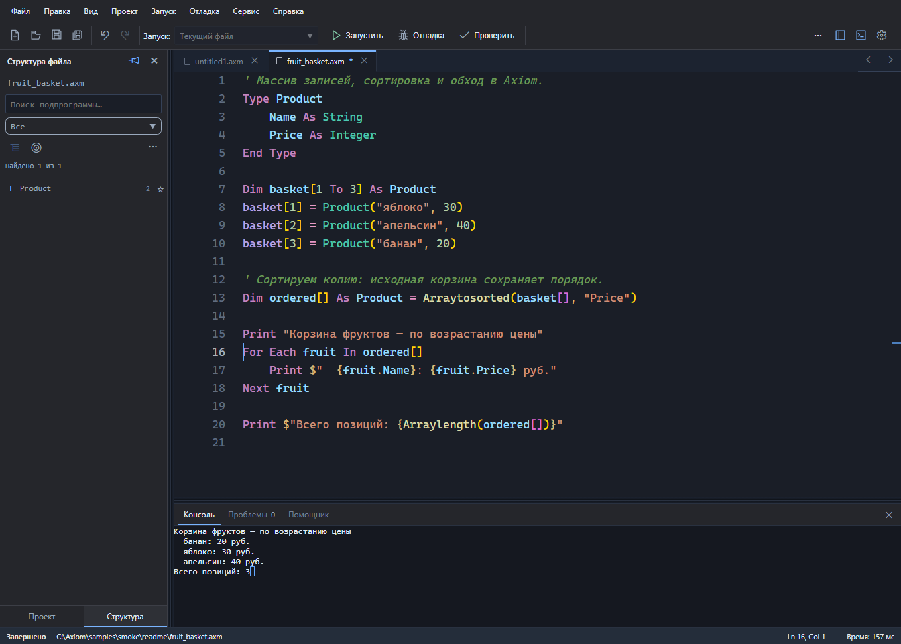

# Axiom

[Русский](README.md) · [English](README.en.md)

<p align="center">
  
</p>

<p align="center"><strong>Синтаксис BASIC, строгие типы и собственная среда разработки.</strong></p>


<p align="center">
  <a href="https://softhitssofthits-dotcom.github.io/Axiom/">📖 Справочник языка</a> ·
  <a href="#быстрый-старт">🚀 Быстрый старт</a> ·
  <a href="samples/">🧩 Примеры программ</a> ·
  <a href="https://github.com/softhitssofthits-dotcom/Axiom/issues">💬 Обсуждение и ошибки</a>
</p>

**Axiom** — самостоятельный язык программирования из семейства BASIC и настольная IDE для него. Здесь можно начать с небольшой консольной программы, перейти к массивам и собственным типам, а затем написать графическую программу или небольшую игру — в одной среде, со справочником и отладчиком под рукой.

Исходники хранятся в файлах `.axm`. Компилятор переводит программу в байт-код, который исполняет виртуальная машина Axiom.

[](assets/readme/axiom-ide.png)

*Настоящий снимок Axiom IDE: программа сортирует корзину фруктов по цене. [Открыть этот пример](samples/smoke/readme/fruit_basket.axm).*

## Знакомая запись, современные возможности

Небольшую программу можно прочитать целиком:

```basic
DIM fruits[] AS STRING = ["яблоко", "банан", "апельсин"]

FOR EACH fruit IN fruits[]
    PRINT $"В корзине: {fruit}"
NEXT fruit

PRINT $"Всего фруктов: {ARRAYLENGTH(fruits[])}"
```

```text
В корзине: яблоко
В корзине: банан
В корзине: апельсин
Всего фруктов: 3
```

Квадратные скобки обозначают массивы, круглые — вызовы функций. Строковая интерполяция вставляет значения прямо в текст, а `FOR EACH` обходит элементы без ручного управления индексом.

| Область | Что есть в Axiom |
|---|---|
| **Типы и числа** | Строгая типизация, `BOOLEAN`, `INTEGER`, `LONG`, `DOUBLE`, `DECIMAL`, строки, даты, время и UTC |
| **Массивы и коллекции** | Литералы `[...]`, многомерные массивы, произвольные границы, представления, `REDIM PRESERVE`, сортировка записей по полю, поиск, фильтрация и свёртка; типизированный словарь `DICTIONARY(ключ, значение)` с `Add`, `Exists`, `Remove`, `Keys`, `Count` и `TryGetValue`; типизированное множество `HASHSET(тип элемента)` с `Add`, `Contains`, `Remove`, `Count`, `ToArray`, `UnionWith` и `IntersectWith` |
| **Собственные типы** | `TYPE` с полями, методами и конструкторами; литералы записей и структурное сравнение |
| **Функции и модули** | `SUB`, `FUNCTION`, `BYVAL`/`BYREF`, вложенные подпрограммы, функции как значения, замыкания, `IMPORT`, `PUBLIC` и `PRIVATE` |
| **Строки и ошибки** | Интерполяция `$"..."`, средства Unicode, регулярные выражения, `TRY` / `CATCH` / `FINALLY` |
| **Файлы и время** | Текстовый ввод-вывод, каталоги и пути, функции дат, времени и часовых поясов |
| **Графика и события** | Классический `SCREEN`, современный `CANVAS`, изображения, спрайты, тайловые карты Tiled, клавиатура и мышь |

В текущем справочнике — **282 встроенные функции и 355 форм вызова**. Возможности и ограничения каждой формы описаны в [справочнике языка](https://softhitssofthits-dotcom.github.io/Axiom/).

## IDE: от первой строки до отладки

Редактор построен на Monaco, консоль — на xterm.js. Служебный процесс .NET связывает редактор с компилятором и виртуальной машиной.

| Во время работы | Средства IDE |
|---|---|
| **Писать** | Подсветка синтаксиса, дополнение кода, подсказки с типами, диагностика во время набора |
| **Находить** | Структура программы, переходы к подпрограммам, связи «кто вызывает / что вызывает» |
| **Запускать** | Встроенная консоль, ввод `INPUT`, запуск и остановка; отдельные графические окна |
| **Разбираться** | Точки останова, пошаговая трассировка, заход в подпрограмму, выход из неё и шаг назад |
| **Организовывать** | Несколько файлов, проекты `.axproj`, исходники и ресурсы в дереве проекта |
| **Настраивать** | Четыре темы, два стиля записи кода, русский и английский интерфейс |
| **Сохранять** | Проверка конфликтов внешних изменений и восстановление завершённых правок после аварии |

### Трассировка и отладка

Остановитесь на нужной строке и проследите выполнение программы по шагам. Можно зайти внутрь функции, выполнить вызов целиком, вернуться к вызывающему коду или сделать шаг назад. Текущая строка выделяется в редакторе; при обходе массива строка состояния показывает текущий элемент.

[](assets/readme/axiom-debugger.png)

*Остановка перед выводом очередного фрукта: видны точка останова, текущая инструкция и команды пошагового выполнения.*

### Classic и Modern — два стиля одного языка

Любите заглавные операторы классического BASIC или предпочитаете более спокойную запись? Форматтер поддерживает оба варианта:

| Classic | Modern |
|---|---|
| `DIM fruits[] AS STRING` | `Dim fruits[] As String` |
| `FOR EACH fruit IN fruits[]` | `For Each fruit In fruits[]` |
| `PRINT fruit` | `Print fruit` |
| `NEXT fruit` | `Next fruit` |

Смысл программы сохраняется: меняется оформление ключевых слов, типов и встроенных функций. Выбор стиля записи независим от темы интерфейса.

<details>
<summary><strong>Посмотреть ту же программу в стиле Modern</strong></summary>



</details>

Темы интерфейса: **светлая**, **тёмная**, **QuickBASIC** и **Borland Pascal**. На снимках показана тёмная тема.

## Попробовать на примерах

| Программа или раздел | Что посмотреть |
|---|---|
| [Корзина фруктов](samples/smoke/readme/fruit_basket.axm) | Программа со снимка: `TYPE`, сортировка по полю, `FOR EACH` и интерполяция |
| [Литералы массивов](samples/expressions/array-literals/) | Короткая запись наборов значений и определение типа элементов |
| [Операторы языка](samples/operators/) | Небольшие примеры отдельных конструкций |
| [Встроенные функции](samples/functions/) | Программы по именам функций |
| [Графика](samples/graphics/) | Рисование, изображения, спрайты и тайловые карты |
| [Maze Chase](samples/graphics/game/maze_chase_project/README.md) | Многофайловый игровой проект с ресурсами и описанием `.axproj` |

## Быстрый старт

Для запуска из исходников нужны **Windows**, **.NET SDK 10** и **Node.js с npm**.

```powershell
git clone https://github.com/softhitssofthits-dotcom/Axiom.git
cd Axiom
.\run-ide.bat
```

Скрипт проверяет инструменты, собирает необходимые компоненты и устанавливает зависимости IDE. При первом запуске понадобится доступ к сети для загрузки пакетов.

В IDE откройте [пример корзины](samples/smoke/readme/fruit_basket.axm) или другой `.axm`, нажмите **«Проверить»**, затем **«Запустить»**. Многофайловые программы открываются через `.axproj`.


## Почему появился Axiom

В школьные годы мне очень нравился BASIC. Прошло время, но желание снова писать в знакомом, понятном синтаксисе осталось. Axiom — личный открытый проект, в котором эта идея встречается с современными типами, графикой и инструментами разработки.

Проект создаёт один автор вместе с ИИ-агентами: автор определяет замысел и правила языка, агенты помогают с реализацией, проверками и документацией. Мне интересны и сам язык, и этот способ работы над ним.

Буду рад людям, которым близок BASIC, критике и предложениям. Найденная ошибка, небольшой пример или обсуждение спорного решения помогают проекту развиваться. [Открыть issue →](https://github.com/softhitssofthits-dotcom/Axiom/issues)

## Документация и исходники

- **[Справочник языка онлайн](https://softhitssofthits-dotcom.github.io/Axiom/)** — синтаксис, правила, примеры и поиск по темам.
- [Локальная версия справочника](docs/manual/index.html).

| Каталог | Содержимое |
|---|---|
| `src/` | Компилятор, байт-код, виртуальная машина и службы .NET |
| `ide/` | Интерфейс Electron, редактор Monaco и консоль |
| `samples/` | Запускаемые примеры по темам |
| `docs/manual/` | Справочник, доступный и без сети |

## Состояние проекта

Axiom находится в ранней разработке. Текущие версии: язык `0.12.0`, компилятор `0.13.24`, IDE `0.15.3`. Основная платформа — Windows. Язык и IDE продолжают меняться; готовая переносимая поставка и поддержка других платформ пока не заявлены.

## Лицензия

[MIT](LICENSE). Спасибо сообществу BASIC и авторам .NET, Electron, Monaco и xterm.js — инструментов, на которых построен Axiom.
