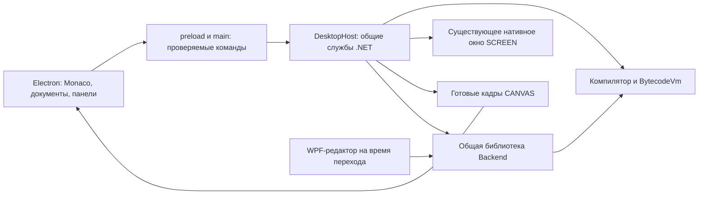

# Замена оболочки IDE Axiom — подробный план реализации

> Для исполняющего агента: выполнять последовательно, отмечая только проверенные пункты. Сначала прочитать AGENTS.md, документы проекта и раздел 15 этого плана. Наличие файла, кнопки или успешной сборки не означает завершения возможности. Не начинать реализацию по одному этому заголовку: читать также таблицу сохранности и договор обмена.

**Дата:** 2026-10-10, Europe/Moscow. **Статус:** план подготовлен; реализация по этому плану не начата. Поручение текущей задачи — только планирование. Архитектурные решения ниже являются проектом следующего изменения, а не описанием уже работающего кода.

**Цель:** заменить основную WPF-оболочку на Electron-интерфейс по визуальному ориентиру IDE X Sharp, сохранив возможности действующей Axiom IDE и единственный компилятор байт-кода / BytecodeVm.

**Архитектура:** Electron отвечает за окно, Monaco, документы и панели. Долгоживущий служебный процесс .NET отвечает за существующие службы исполнения, ввод, графику и отладку. WPF-IDE и служебный процесс используют общие службы; второго исполнения языка не появляется. Отдельное нативное окно SCREEN сохраняется; WPF-зависимости графики допустимы внутри служебного процесса Windows.

**Стек:** существующие .NET 10 / Windows, Electron, Monaco и обычный JavaScript. Точные версии берутся из lock-файлов после проверки этапа 0. React, новый сборщик, новый язык реализации интерфейса и смена графического движка в этот переход не входят.



Стрелки обозначают владение/вызовы, а не второй путь исполнения языка. У двух представлений общая реализация служб; после завершения перехода узел WPF-редактора удаляется.

Связанные документы:

- [Таблица сохранности возможностей](IDE_SHELL_FEATURE_MATRIX.csv) — обязательный перечень с источниками и проверками.
- [Договор обмена оболочки и служебного процесса](IDE_SHELL_PROTOCOL.md) — состояния, команды, события, ввод, отладка, графика.
- [Результат отказа от интерпретатора](INTERPRETER_REMOVAL_RESULT.md) — исходная точка и ограничения прежних проверок.
- `docs/ELECTRON_IDE_PLAN.md` — исторический план прототипа; его исключения графики и отладки не являются границами новой основной IDE.

## 1. Что проверено при подготовке

Рабочая копия — C:\Axiom, ветка master, HEAD af0959985500750d2f644da6b5ffd3d116cc9823. Реализация перехода на одну VM находится в незакоммиченном рабочем дереве. Последняя сводка сообщает 6032/6032, девять проектов и восемь живых сценариев WPF. В данной задаче эти длительные проверки повторно не выполнялись; будущий этап 0 обязан получить свежую исходную точку.

Локальные ветки: master и local/wip-block-scope-for-counter. Electron-прототип существует в ide/ основной ветки. Коммит 2904ee9 уже является предком master и присутствует также в старой локальной ветке. Второй активной рабочей копии Git не обнаружено. Не переключаться на старую ветку ради интерфейса: это может вернуть прежнее ядро и потерять текущие изменения.

Референс реально находится в C:\X__sharp\ide. Проверены его package.json, index.html, design-system.css и структура main/renderer/e2e. Основные зависимости совпадают с Axiom-прототипом. CSS Axiom содержит заимствованные переменные --xs-*, меню и терминал повторяют устройство референса. Это заготовка, а не подтверждение функциональной полноты.

В Axiom-прототипе обнаружены конкретные ограничения:

1. runConsole запускает `axiom run <file>` через ConPTY. ConsoleHost явно отклоняет SCREEN/CANVAS; клавиатура и мышь полноценной IDE не предоставляются.
2. preload.js не содержит команд отладчика; графические и отладочные службы доступны в WPF.
3. app.js отказывается запускать несохранённый документ через сообщение, тогда как WPF предлагает сохранение и затем выполняет подготовленный файл. Следует сохранить именно сценарий WPF с возможностью отмены.
4. Прототип использует F5 для обычного запуска. В WPF Ctrl+F5 — обычный запуск, F5 — начало/продолжение отладки. F3 — поиск следующего совпадения, а не форматирование.
5. CLI fmt всегда выбирает Classic; действующая WPF-IDE имеет Classic, Modern, умные идентификаторы и структурное редактирование.
6. Проверка свежести CLI сопоставляет HEAD с ревизией сборки. Незакоммиченные изменения имеют тот же HEAD: одного этого сравнения недостаточно.
7. app.js, ipc.js и обработчики WPF объединяют много обязанностей; перенос их целиком в новый монолит затруднит проверку.
8. Нынешние 11 Electron e2e-сценариев включают ожидание отказа графики. Их прежний успех не доказывает пригодность новой основной среды.

## 2. Решения и границы

### 2.1. Рассмотренные варианты

| Вариант | Что даёт | Цена и ограничение |
|---|---|---|
| Изменить только оформление WPF | Минимальный риск, все службы остаются на месте | Не использует выбранную Electron-оболочку и Monaco; не выбран основным направлением |
| Electron + повторная реализация графики и отладчика на JavaScript | Полностью браузерное представление | Наибольший риск изменения языка, пикселей, событий и шагов; не выбран |
| **Electron + общие службы .NET в отдельном процессе** | Новая оболочка и сохранение существующих функций | Нужно выделить зависимости и определить обмен; выбран для этого плана |

Служебный процесс — часть одной IDE. Он не является вторым компилятором, вторым языком или скрытым запуском полного WPF-редактора. В пользователе должен быть виден один редактор и, при SCREEN, предусмотренное графическое окно программы.

### 2.2. Сохранить обязательно

Все строки IDE_SHELL_FEATURE_MATRIX.csv должны получить доказательства и состояние ПРОВЕРЕНО до переключения основной среды. Графика, ввод, остановка и отладчик не могут остаться «когда-нибудь потом». Неактивная кнопка, ссылка «запустите WPF» или красивый макет не считаются переносом.

Дополнение, подсказки сигнатур, живые диагностики и структура из нынешнего прототипа тоже сохраняются. Их клиентский приблизительный анализ не становится источником семантики языка; ошибки и зарегистрированные формы поступают из ядра.

### 2.3. Не включать в эту работу

- Новые операторы, изменение POW, числового договора, форматирования строк программы или поддержки файлов.
- Создание самостоятельных исполняемых программ Axiom, оптимизация VM и смена графического движка.
- Полную систему многофайловых проектов, расширения IDE, синхронизацию с облаком и другие платформы.
- Новый полноценный инспектор переменных/стека, если его нет в текущем интерфейсе. Переносятся существующие возможности отладчика; новая функциональность требует отдельного решения.
- Принудительное исследование отложенной пользователем аварии WPF. Потери связи новой оболочки проверить нужно, но не объявлять это закрытием прежнего отложенного вопроса.

### 2.4. Безопасное сосуществование

До заключительного принятия `src/Axiom.Ide` запускается прежней командой и остаётся работоспособным. Новая среда имеет отдельную команду разработки, каталог состояния и журналы. Общие библиотеки единственные, а представления временно два. После принятия Electron становится основным запуском; удаление старой редакторной оболочки выполняется заключительным отдельным этапом. Нативная графическая библиотека остаётся.

## 3. Внешний вид, который нужно получить

Ориентир — компактная рабочая среда X Sharp: верхнее меню, небольшая панель действий, дерево файлов слева, вкладки и редактор в центре, изменяемая нижняя панель и строка состояния. Переносить композицию и удобство, сохраняя Axiom-меню и договор команд.

```text
┌ Файл  Правка  Формат  Поиск  Запуск  Отладка  Вид  Справка ┐
│ Новый  Открыть  Сохранить │ Компиляция  Запуск  Отладка ... │
├──────────────┬───────────────────────────────────────────┤
│ Файлы        │ Вкладки документов                        │
│              ├───────────────────────────────────────────┤
│ Каталог      │ Monaco: код, номера строк, точки,         │
│ и файлы      │ текущая строка и диапазон отладки          │
│              ├───────────────────────────────────────────┤
│              │ Вывод │ Ошибки │ Структура │ Журнал        │
│              │ Вывод программы / запрос INPUT / CANVAS   │
├──────────────┴───────────────────────────────────────────┤
│ Состояние  Файл  Строка:столбец  Компиляция/исполнение     │
└──────────────────────────────────────────────────────────┘
```

Это структурная схема, не утверждённый пиксельный макет. На этапе 1 подготовить реальные изображения светлой и тёмной темы и получить выбор автора до массового оформления. Работа над договорами и проверками не зависит от оттенка акцента.

Начальные параметры для макета: панель действий 32 px, строка состояния 25 px, вкладки 34–38 px, дерево 240 px с изменением ширины, нижняя панель около 28% высоты, шрифт кода 14 px. Значения допускают корректировку при принятии макета; они не должны ограничивать содержимое или ломать масштабирование.

Обязательные состояния макета: пустая среда, два документа/несохранённый документ, ошибки, INPUT, остановка отладчика, CANVAS, узкое окно. Для каждого проверить темы и видимость фокуса. SCREEN остаётся отдельным окном программы.

Функции Axiom должны быть доступны через меню, горячую клавишу и предусмотренную панель, где они есть сейчас. Не добавлять в меню неработающие функции X Sharp, символические палитры, соглашение main-файла или терминологию чужого языка.

## 4. Будущая структура и ответственность

Новые пути ниже запланированы и пока не существуют. Не выдавать их за уже доступные проекты.

| Путь | Ответственность |
|---|---|
| src/Axiom.Ide.Contracts/ | Чистые DTO обмена, состояния и версии; net10.0, без WPF и VM-объектов |
| src/Axiom.Ide.Backend/ | Общие службы выполнения, ввода, графики и отладки; net10.0-windows, WPF/Direct3D только там, где нужны существующему графическому хосту |
| src/Axiom.Ide.Backend/Execution/ | Перенесённые ProgramRunService, адаптер отладчика, управление сессией; один экземпляр служб на запуск |
| src/Axiom.Ide.Backend/Input/, Graphics/ | Перенесённые существующие службы и графический буфер, нативное окно, маршрутизация ввода |
| src/Axiom.Formatting/StructuralEditing/BlockEditPlanner.cs | Чистое планирование структурных правок текста без AvalonEdit; одинаковые правила для обоих представлений |
| src/Axiom.DesktopHost/ | Исполняемый процесс Windows: STA Dispatcher, чтение/запись протокола, сериализация команд и завершение |
| ide/src/main/backend-client.js | Запуск и контроль DesktopHost, запросы/события, завершающая очистка |
| ide/src/main/backend-ipc.js | Проверяемый мост main/preload, без общей функции «выполни произвольный метод» |
| ide/src/main/file-service.js | Документы и файловые операции Electron, диалоги, корзина, наблюдение; Windows-пути |
| ide/src/main/settings-service.js | Версионированное состояние, чтение старых форматов, атомарная запись |
| ide/src/renderer/commands.js | Единая таблица команд, клавиш и доступности |
| ide/src/renderer/documents.js | Модели документов, dirty, вкладки, сохранение и закрытие |
| ide/src/renderer/editor-service.js | Monaco, события редактора, форматирование, выделение, точки останова |
| ide/src/renderer/run-session.js | Отображение состояния выполнения и защита от старых событий |
| ide/src/renderer/output-panel.js | Читаемый и обратимый вывод, запрос INPUT, очистка и копирование |
| ide/src/renderer/debugger-panel.js | Точки/диапазон, доступность шагов и состояния отладчика |
| ide/src/renderer/canvas-view.js | Представление готового кадра CANVAS и пересчёт ввода; без алгоритмов рисования языка |
| tests/Axiom.DesktopHost.Tests/ | Процессные договоры, состояния, отмена, вывод и ввод |
| tests/Axiom.Ide.Backend.Tests/ | Перенесённые проверки общих служб, если они больше не принадлежат WPF-оболочке |
| ide/tests/ | Чистые Node-проверки моделей, команд, сообщений и настроек |
| ide/e2e/specs/ | Настоящая Electron-IDE; отдельные сценарии сохранности и графики |

Дополнительные существующие точки: src/Axiom.Ide/Services/Execution/, Services/Input/, Services/Graphics/, Graphics/, Models/, Services/EventLog/, Services/Diagnostics/ и Services/Shell/IdeShellCompositionRoot.cs. ProgramRunService сегодня обращается к IdeLanguageResourceService; убрать зависимость общей службы от ресурса MainWindow через внедрённый поставщик сообщений. Сохранить исходные тексты и коды.

При выделении сохранить существующие пространства имён на первом проходе, если это уменьшает миграционный шум. Каждый исходный файл должен компилироваться ровно в одной общей библиотеке. Не использовать одновременно физическую копию и Compile Include из старого проекта. Не ссылаться из DesktopHost на исполняемый WPF-проект с AvalonEdit и MainWindow.

В Axiom.Ide.Backend допустим System.Windows.Threading для сохранённой графики; это не библиотека, независимая от Windows. Адаптеры AvalonEdit, MainWindow, диалоги редактора и тема WPF остаются в старой оболочке до её удаления. При обнаружении новой зависимости сначала дописать карту конкретных файлов, а не переносить всё src/Axiom.Ide.

Две проверенные зависимости требуют отдельной работы: AxiomBlockEditingService принимает AvalonEdit.TextDocument, поэтому его нельзя просто перенести в хост; нужен общий планировщик правок и тонкий прежний адаптер. ProgramDiagnosticItem хранит line/column/length, но не абсолютный span: для нового DTO получать диапазон из исходного Diagnostic до потери при отображении, сохранив совместимость существующих полей.

## 5. Порядок этапов

Этапы выполняются последовательно. Внутри этапа — небольшие изменения с проверками. Авторизация на реализацию, коммит и push определяется текущим поручением, а не примерами команд в плане. Этот документ не разрешает автоматически публиковать все изменения.

### Этап 0. Зафиксировать исходную точку и воспроизводимые проверки

**Читать:** AGENTS.md, PROJECT.md, активные документы, INTERPRETER_REMOVAL_RESULT.md и JSON доказательств. **Записывать:** docs/plans/IDE_SHELL_BASELINE.md и .artifacts/ide-shell/baseline/.

- [ ] Выполнить `git status --short`, `git diff --stat`, `git branch -av`, `git worktree list`; сохранить вывод и текущий hash. Отделить пользовательские удаления .playwright-mcp/* от перехода.
- [ ] По разрешённому объёму зафиксировать переход на VM перед крупным изменением. Если поручение не включает коммит, сохранить снимок/перечень и работать без потери исходной точки; не делать reset/checkout поверх грязного дерева.
- [ ] Последовательно собрать решение и выполнить текущую регрессию, список обнаружения и Node-тесты по разделу 12. Не принять старый JSON за свежий запуск.
- [ ] Прочитать ровно существующие e2e и сравнить ожидания с целевыми. До запуска удостовериться в изоляции APPDATA, LOCALAPPDATA, userData, состояния WPF и процессной очистки. Старый helper не считать безопасным по названию.
- [ ] После изоляции запустить текущую Electron e2e-сюиту и записать каждую ошибку/неподдержанную возможность отдельно. Не исправлять код языка ради исходного прототипа.
- [ ] Собрать список реальных версий из lock-файлов, .NET SDK, ОС и масштабирования экрана. Не обновлять все зависимости «заодно».
- [ ] Сделать копии только пользовательских настроек для восстановления, не печатать их целиком в журнал. Все будущие UI-проверки используют отдельные каталоги и именованную блокировку.

**Выход:** свежая исходная сводка, список тестов, пользовательские изменения сохранены. Число 6032 — ориентир прошлого прогона, не вечная константа. Снижение числа тестов требует объяснения по методам.

### Этап 1. Карта сохранности и принятый макет

**Читать:** MainWindow.xaml/.xaml.cs, MainWindowViewModel*.cs, Editor/, ide/src/renderer/, C:\X__sharp\ide\src\renderer\. **Создать:** docs/plans/IDE_SHELL_VISUAL_SPEC.md. **Обновлять:** CSV сохранности.

- [ ] Проверить каждую строку CSV по текущему коду; добавить найденные пользовательские действия, даже если у них нет отдельного теста.
- [ ] Зафиксировать точные команды, клавиши, состояние доступности, диалоги и сохранение. Для Ctrl+F5/F5/F3 использовать Axiom, не X Sharp.
- [ ] Подготовить светлый/тёмный макет всех состояний из раздела 3 с меню Axiom и реальным объёмом кнопок отладки.
- [ ] Показать макет автору и сохранить принятое решение в VISUAL_SPEC. Если внешний вид ещё не выбран, продолжать выделение служб; не массово перекрашивать интерфейс без выбранного образца.
- [ ] Составить карту «элемент WPF → элемент Electron → команда → проверка», включая скрываемые панели, контекстные меню и строку состояния.

**Выход:** нет потерянной функции; автор выбрал конкретный вид. Макет не считается выполнением последующих этапов.

### Этап 2. Выделить общие службы без изменения поведения

**Создать:** проекты Contracts и Backend из раздела 4. **Изменить:** Axiom.sln, Axiom.Ide.csproj, IdeShellCompositionRoot.cs и ссылки соответствующих тестов.

- [ ] Начать с DTO результатов, статусов и DebuggerStopInfo; записать поле SourceLocation без потери диапазона. VM StopState в DTO не включать.
- [ ] Общий ViewModelBase использует только INotifyPropertyChanged: перенести его в Backend/Common один раз и оставить общую ссылку WPF. Dispatcher внедрить в ProgramConsoleService явно; не рассчитывать на Application.Current старого редактора в отдельном хосте.
- [ ] Перенести ProgramRunService и BytecodeVmDebuggerAdapter с теми же проверками. Внедрить поставщик локализованных сообщений вместо прямой зависимости от Shell-ресурсов.
- [ ] Перенести ConsoleOutputService, InputPromptService, InputStateService, SessionManager, ProgramConsoleService и все его partial-файлы. До переноса найти их через `rg --files src/Axiom.Ide/Services/Input`.
- [ ] Перенести GraphicsHostService, ScreenFramebuffer, ScreenTextBuffer/Rasterizer, Direct3D11SwapChainRenderer, NativeGraphicsScreenWindow и необходимые договоры маршрутизации. Сохранить палитры, страницы, физические/логические координаты и публикацию кадров.
- [ ] Отделить общий журнал от WpfIdeEventLogViewerService: формат события общий, окно просмотра принадлежит представлению.
- [ ] Для диагностик добавить необязательные spanStart/spanLength из исходного Diagnostic на границе ProgramRunService до создания ProgramDiagnosticItem. Сохранить старые свойства/проверки WPF и честное отсутствие позиции инфраструктурной ошибки.
- [ ] Оставить WPF-композицию использующей эти же службы. Проверить ProgramRunServiceTests, ConsoleOutputServiceTests, ProgramConsoleServiceTests, InputPromptServiceTests, маршрутизаторы и графические проверки.
- [ ] Проверить сборку и живые SCREEN/CANVAS/INPUT/отладку старой IDE после выделения. Если они сломаны, не переходить к новому оформлению.

**Выход:** общие службы действительно используются WPF; вычислительная семантика и проверки не переписаны. Нет копии графического движка и ссылки нового процесса на MainWindow.

### Этап 3. Служебный процесс и договор обмена

**Создать:** src/Axiom.DesktopHost/{Program.cs,HostApplication.cs,Protocol/JsonLineTransport.cs,Protocol/RequestDispatcher.cs,Execution/HostSession.cs,Execution/HostCommandQueue.cs}; тесты DesktopHost. Полный договор — IDE_SHELL_PROTOCOL.md.

- [ ] Организовать STA Dispatcher с работающим циклом сообщений. Создавать графические объекты на правильном потоке; чтение команд и VM не должны блокировать Dispatcher.
- [ ] Реализовать hello/ping/shutdown и строгую версию сообщения; stdout содержит только NDJSON, stderr — служебный журнал. Запретить Console.WriteLine вывода программы в этот транспорт.
- [ ] Реализовать запрос/ответ с id, события с sessionId/sequence и явные ошибки протокола. Проверить Unicode, разделённые пакеты, несколько сообщений за чтение и завершение stdin.
- [ ] Организовать одну исполняемую сессию; управляющее чтение не ждёт окончания VM. input.submit и execution.stop принимаются во время INPUT и исполнения.
- [ ] Подключить ProgramRunService без промежуточного CLI run, общий console/input/graphics. Добавить compile, start, stop, debug-команды и события из договора.
- [ ] Создать отдельный канал кадров для CANVAS, не передавать большой кадр как строку рядом с командами остановки. Проверить размеры, формат пикселей и ограниченную очередь.
- [ ] Процессные проверки: компиляция с BackendFailure; вывод нового compiler_execution.axm; INPUT; бесконечный цикл/Stop; пауза отладки/Continue; штатное завершение; потеря stdin и принудительное закрытие родителя.

**Выход:** реальный служебный процесс отвечает, принимает Stop при занятой VM, создаёт существующий SCREEN и выдаёт кадр CANVAS. Если с этими службами не удаётся обеспечить Dispatcher/отмену, остановить внедрение интерфейса и записать конкретный блокер.

### Этап 4. Мост Electron → .NET и ранняя проверка сложных функций

**Создать:** backend-client.js, backend-ipc.js, ide/tests/backend-client.test.cjs, ide/e2e/specs/backend.spec.js. **Изменить:** main.js, preload.js, ipc.js.

- [ ] Запускать DesktopHost через spawn с массивом аргументов, shell:false и windowsHide:true. Передавать отдельный каталог данных и канал кадров, известные main-процессу.
- [ ] Дождаться hello и проверить совпадение версии протокола/возможностей. Нельзя показать «готово» при отсутствующем хосте.
- [ ] В preload предоставить только именованные методы и подписки с функцией отписки. Валидировать sender, типы, длины и состояние; не отдавать renderer сырой ipcRenderer или child_process.
- [ ] При закрытии послать shutdown, дождаться завершения, затем ограниченно закрыть только собственный PID и потомков. Не делать taskkill по имени всех dotnet/axiom/Electron.
- [ ] Устранить ложную свежесть незакоммиченного кода: для разработки подписывать сборку хешем входных исходников/проектов и сверять его, для поставки использовать manifest. HEAD — дополнительное поле, не единственное условие.
- [ ] Через минимальные кнопки/тестовый интерфейс проверить четыре настоящих сценария: INPUT → ввод; SCREEN → нативное окно; CANVAS → пиксели; breakpoint → Continue. Эти проверки проходят до крупной переделки редактора.
- [ ] Старый runConsole перестаёт быть основным путём. Не выбирать исполнение на основании наличия слова SCREEN в исходнике. Все программы основной IDE идут в один DesktopHost.

**Выход:** архитектура пригодна для всех обязательных режимов; нет двух отдельных путей исполнения разных программ.

### Этап 5. Документы, вкладки и редактор

**Создать:** documents.js, editor-service.js, commands.js и чистые тесты; ide/e2e/specs/documents.spec.js. **Изменить:** app.js, index.html, lang-features.js.

- [ ] Выделить documentId, path, sourceText, revision, savedRevision, readonly, Monaco model, viewState и breakpoints. documentId стабилен при SaveAs, revision увеличивается при правке.
- [ ] Один Monaco model на документ; при смене вкладки сохранить undo/redo, выделение, прокрутку и точки. При закрытии освободить model/подписки, при отмене закрытия — ничего не уничтожить.
- [ ] Перенести New/Open/Save/SaveAs/SaveAll/Close/Exit с сохранением/отменой. Диалог SaveAs, закончившийся отменой или ошибкой, не очищает dirty.
- [ ] Сохранить UTF-8, пути Windows, CRLF/LF, русские имена и поведение неподдерживаемого формата/read-only по существующим службам и тестам.
- [ ] Перенести поиск/замену: направление, регистр, целое слово, регулярное выражение, некорректный regex, одно/все совпадения, F3/Shift+F3. Не считать встроенную панель Monaco достаточной без проверки договора WPF.
- [ ] Подсветку и сигнатуры строить из актуальных metadata. Проверить интерполяцию, строки с апострофом/REM, &H, Unicode и встроенные формы. Клиентский scanDoc не должен обрезать строку как комментарий.
- [ ] Привязать единый реестр команд к меню/кнопкам/клавишам. Проверить фокус: Ctrl+S не уходит в терминал, F5 не запускает второй процесс.

**Выход:** документы ведут себя как в Axiom; все документы можно закрыть и отменить закрытие без потери текста. Новые тесты проверяют результат, а не только число вкладок.

### Этап 6. Файловая панель и операции Windows

**Создать:** file-service.js, ide/tests/file-service.test.cjs, ide/e2e/specs/files.spec.js. **Читать:** src/Axiom.Ide/Files/FileTreeService.cs, FileOperationsService.cs, FilesPaneViewModel.cs.

- [ ] Перенести навигацию по каталогам, обновление, скрытые элементы, открытие файла/каталога и внешнее открытие.
- [ ] Реализовать создание файла/каталога, переименование, вырезание/копирование/вставку, свойства и удаление в корзину. shell.trashItem использовать как корзину; не заменять её fs.rm.
- [ ] При конфликте назначения, locked/read-only, недоступном каталоге и ошибке операции показать понятный результат, не менять вкладку на несуществующий путь.
- [ ] При переименовании открытого файла согласовать пути вкладки, диагностики и breakpoints. Во время выполняемой сессии исходный снимок неизменен.
- [ ] Одна вкладка на один нормализованный Windows-путь; не применять toLowerCase к самому имени создаваемого файла. Отличать отображение пути от ключа сравнения.
- [ ] Внешнее изменение/удаление: чистый документ может быть обновлён; dirty требует решения, его текст не затирать автоматически. Наблюдатели освобождать при закрытии.

**Выход:** все операции выполняются в выделенном проверочном дереве, корзина и отмена проверены на реальной Windows.

### Этап 7. Компиляция, диагностика и форматирование

**Создать:** renderer/diagnostics-panel.js, renderer/formatting-service.js, e2e/specs/editor-contract.spec.js. **Читать:** Axiom.Formatting/, Editor/StructuralEditing/, Editor/Identifiers/, DocumentFormattingPolicy.cs.

- [ ] Explicit Compile соблюдает сохранение/отмену текущей WPF-IDE. Живая проверка имеет отдельный путь анализа снимка буфера и не сохраняет документ.
- [ ] Каждому анализу присвоить documentId/revision. Результат старого текста не перекрашивает новый текст и другую вкладку. При закрытии отменить/игнорировать запрос.
- [ ] Получать stage/code/message/severity/range из ядра. Не переводить тексты диагностик повторным regex и не объединять разные ошибки только по сообщению.
- [ ] Перенести список, копирование, переход к точному диапазону и различение ошибок компиляции/исполнения/инфраструктуры. Проверить пустую строку, EOF, CRLF и символ вне BMP.
- [ ] Форматировать через общий Axiom.Formatting с явным Classic/Modern. Текущее CLI fmt не передаёт выбор, поэтому использовать format.document DesktopHost из договора.
- [ ] Перенести умные идентификаторы и структурное редактирование по существующим службам; менять только нужный диапазон, сохранять undo одной операции и каретку. Не форматировать read-only/неподходящий файл.
- [ ] Умные идентификаторы вызывают существующий IdentifierNormalizationService из Axiom.Execution; новый алгоритм имён в JavaScript не писать. Из AxiomBlockEditingService выделить BlockEditPlanner в Axiom.Formatting: вход — sourceText, previousLineNumber, currentLineNumber, caretOffset, style; выход — список TextEdit(start,length,newText) и newCaretOffset. Старый адаптер применяет их к TextDocument, новый — к Monaco. Перенести независимые ожидания BlockEditingServiceTests и проверить CRLF/закрывающий блок/ветвь/одну undo-операцию; не оставлять две реализации правил.
- [ ] Проверить дополнение/hover/структуру для SUB/FUNCTION/TYPE, BYREF и замыканий; приблизительный список структуры не обещает полного связывания.

**Выход:** compile без готового байт-кода не получает Success; режимы форматирования и пользовательские имена не утрачены.

### Этап 8. Выполнение, вывод, INPUT и отмена

**Создать:** run-session.js, output-panel.js, e2e/specs/run-contract.spec.js. **Читать:** ProgramRunService, ConsoleOutputService, InputPromptService и ViewModels/MainWindowViewModel.Debug.cs.

- [ ] Реализовать подготовку сохранённого активного файла: dirty/untitled → предложение сохранить → проверка успеха → снимок подготовленного файла → start. Отказ/отмена не запускают старый текст с диска.
- [ ] Обычный запуск Ctrl+F5, отладка F5. У каждого start новый sessionId; второй запуск блокируется состоянием хоста, а не только кнопкой renderer.
- [ ] Вывод получать как text-delta / replace / clear с версией. Сохранять пустые PRINT, продолжение строки, Unicode, прокрутку и копирование. Поля статуса не дописывать в вывод самой программы.
- [ ] INPUT показывает запрос и отдельное поле; отправка ровно одного inputRequestId, пустая строка допустима. Повторный Enter и ввод для старой сессии отклоняются. Два запуска подряд не наследуют ввод.
- [ ] Передавать cancel в ожидание INPUT, SLEEP и VM; событие Cancelled приходит после фактического прекращения. Если через 5 секунд хост не завершил отмену, показать зависание и закрыть только собственный процесс с пометкой принудительного прекращения.
- [ ] Проверить относительные ресурсы и CHANGEDIR: база сохранённого файла, состояние каталога на сессию, без изменения Environment.CurrentDirectory main/host.
- [ ] При ошибке транспорта показывать инфраструктурную ошибку, не Success. Следующий запуск создаёт чистую сессию; паузу VM и ввод не восстанавливать из JSON.

**Выход:** PRINT/INPUT/Stop и повтор независимы; вывод и код ошибки проверены точными ожиданиями нового compiler_execution.axm.

### Этап 9. Полная графика и маршрутизация ввода

**Создать:** canvas-view.js, main/frame-client.js, DesktopHost/Graphics/FrameChannel.cs, e2e/specs/graphics-contract.spec.js. **Сохранять:** общую графическую библиотеку из этапа 2.

- [ ] SCREEN создаёт существующий NativeGraphicsScreenWindow; сохранить размер/режим/страницы/Direct3D, клавиатуру, мышь, фокус и предусмотренное завершение при закрытии. Не открывать полный старый редактор.
- [ ] CANVAS отображает снимок существующего буфера в панели, без самостоятельного рисования операторов на JavaScript. POINT, GET/PUT, палитра, clipping и преобразования вычисляются .NET.
- [ ] Сохранить текст графической поверхности, положение курсора/строки и запрос графического INPUT через существующий ScreenTextBuffer/GraphicsText. Не считать передачу одного растрового кадра достаточной для полного экранного вывода.
- [ ] У кадра sessionId/frameId/width/height/stride/format; очередь ограничена, устаревший кадр может быть заменён последним. Завершающий кадр доставляется перед finished или состояние содержит ссылку на последний кадр.
- [ ] CSS-масштаб и devicePixelRatio использовать только для отображения. Ввод переводить в координаты исходного буфера, учитывать отступы, viewport и camera; не умножать координаты дважды.
- [ ] Не терять KeyUp/ButtonUp при потере фокуса; очистить удержанные клавиши, сохранить порядок событий и Unicode INKEY. Во время SCREEN INPUT не делать второй конкурирующий редактор строки в Electron.
- [ ] Проверить SCREEN 10, две экранные страницы/PCOPY, GET/PUT, спрайты, CANVAS/POINT, viewport/window, мышь press/release/wheel, Unicode/LEFT и возврат SCREEN 0. Использовать существующие тематические samples и независимые тесты как эталон.
- [ ] Сравнить текущую VM в WPF и Electron на одинаковых графических нагрузках: показатели кадра, задержки ввода, очередь и память. Сравниваются представления одной VM, не два исполнения языка. Пределы принятия — раздел 12.

**Выход:** реальные окна, пиксели и события проходят. Цвет 15 в индексной палитре не заменять ожиданием RGB 16777215 только потому, что виден белый пиксель.

### Этап 10. Отладчик и неизменность исходного снимка

**Создать:** debugger-panel.js, e2e/specs/debugger-contract.spec.js. **Читать:** IProgramDebuggerState, BytecodeVmDebuggerAdapter, MainWindowViewModel.Debug.cs, BreakpointMargin.cs.

- [ ] Реализовать Start/Continue, StepOver, StepInto, StepOut, StepBack, Stop, Restart, F9 и очистку всех точек. Доступность задаётся состоянием и CanStepBack, а не наличием кнопки.
- [ ] Хранить StopState только в хосте. Renderer передаёт sessionId, stopId и команду; старый stopId после шага отклоняется.
- [ ] Точки привязать к документу/подготовленному исходнику, перенести изменённые строки по результату редактирования. Не применять точку другой вкладки к текущей VM.
- [ ] Сохранять SourceLocation и выделять диапазон, а не только строку. Для символа вне BMP сопоставить UTF-16 offsets и координаты Monaco.
- [ ] StepBack восстанавливает вывод через replace/checkpoint и кадр из существующей способности хоста. Не обещать отмену внешней записи файла или пользовательского ввода, если текущая VM не поддерживает это.
- [ ] При правке исходника во время остановки показывать, что сессия использует прежний снимок. Команды продолжения относятся к нему; Restart проходит подготовку/компиляцию нового текста. Не скрытно менять выполняемый модуль.
- [ ] Повторить независимый сценарий debug_step_controls.axm: Start 1 → Over 2 → Into 5 → Out 2 → Back 5 → Continue; breakpoint 5 → Stop → повтор → breakpoint 5 → Continue. Также отдельно проверить повтор без точки, не опираясь на прежнюю неполную проверку.

**Выход:** шаги меняют реальную VM и события, не только подсветку редактора. Повтор и отмена не оставляют состояния прошлой сессии.

### Этап 11. Настройки, журнал, справка и восстановление

**Создать:** settings-service.js, renderer/event-log-panel.js, e2e/specs/settings-contract.spec.js. **Читать:** RecentFilesState/Snapshot/Service, Services/EventLog/, Services/Diagnostics/, locale.js, docs/manual/.

- [ ] Один владелец записи Electron settings; атомарная запись временного файла в том же каталоге и замена. Версия схемы и резервная копия; повреждённый файл не уничтожается.
- [ ] Однократно импортировать известные поля WPF recent-files.json и старого Electron settings.json в новый каталог. Сопоставить Light/Dark, Russian/English, WindowState, visible panes, smart identifier, последние пути/каталог. Не менять исходные файлы и не восстанавливать уже потерянные значения выдумкой.
- [ ] У неизвестных полей безопасное поведение; PreferredExecutionMode не порождает режим. Повторный импорт не затирает новые предпочтения. При неудаче показать объяснение и оставить исходную копию.
- [ ] Проверить темы/язык, панели и размеры/позицию окна, отключённый монитор, изменение DPI, недавние пути, отсутствующий файл. Не переносить технические processId/stopId в настройки.
- [ ] Перенести просмотр/фильтрацию/копирование журнала, открытие файла/каталога, очистку и индикаторы. Пользовательский текст не превращается в HTML через innerHTML.
- [ ] Открывать существующий manual локально; справка и About описывают компилятор/VM. Имена окон/меню/ошибки запуска локализованы ru/en.
- [ ] Проверить потерю связи с новой службой, закрытие renderer и повторный запуск в изолированных данных. Прежний отложенный дефект WPF отдельно не закрывать.

**Выход:** пользовательские данные сохраняются при перезапуске, миграция не изменяет WPF-файл. Никакой UI-тест не работает с настоящим пользовательским профилем.

### Этап 12. Окончательное оформление и удобство

**Изменить:** index.html, styles.css, design-system.css, locale.js, новые renderer-модули. **Сверять:** принятый VISUAL_SPEC, матрицу возможностей и команды.

- [ ] Применить выбранную композицию и Axiom-названия ко всем состояниям, включая ошибки, пустые панели, ожидание INPUT и отладку.
- [ ] Убрать ненужные X Sharp-элементы/названия, сохранить атрибуцию и лицензии фактически заимствованных материалов. Переименование CSS выполнять отдельно от функциональной миграции.
- [ ] Проверить resize обоих разделителей и сохранение размеров; скрытая панель не лишает программу ввода, активная диагностика открывает нужный документ.
- [ ] Клавиатурная навигация меню, видимый фокус, подписи значков, доступность disabled, контраст и читаемость в обеих темах. Не кодировать ошибку одним цветом.
- [ ] Проверить 800×600, 1280×720 и 1920×1080, масштабы 100/125/150/200%; кнопки не перекрываются, меню не выходит за экран, редактор и вывод прокручиваются.
- [ ] Сохранить снимки выбранных состояний; автор проверяет внешний вид на реальном экране. Автоматические скриншоты не выдавать за субъективное принятие.

**Выход:** внешний вид принят, и каждое действие остаётся связано с проверенной функцией.

### Этап 13. Запуск и локальная поставка без исходной папки

**Создать:** ide/scripts/prepare-desktop-host.js, ide/scripts/package-local.js, docs/plans/IDE_SHELL_PACKAGING.md. **Изменить:** run-ide.bat, package.json, prepare/ensure-скрипты.

- [ ] Определить единственную Release-сборку DesktopHost и её зависимости .NET, графические DLL, ресурсы Monaco/иконки/manual. Путь выводов взять из Directory.Build.props, не src/bin.
- [ ] Разделить режим разработки и готовую локальную поставку. При запуске поставки не нужны Git, dotnet build, npm install и доступ к C:\Axiom.
- [ ] Подготовить локальную переносимую папку Electron с ресурсами и self-contained DesktopHost Windows x64. Это исполняемый файл среды, а не компиляция программ Axiom в native exe.
- [ ] Проверить путь с пробелами/кириллицей, userData вне установки, отсутствие SDK/Git/Node в PATH, чтение manual и запуск графики/INPUT/отладчика. Наличие установленного .NET не считать доказательством self-contained.
- [ ] При отсутствии/несовместимости служебного процесса показать точную ошибку; не запускать устаревший бинарник молча. Копии ресурсов не должны зависеть от файлов референса X Sharp.
- [ ] Прогнать поставку из новой папки на чистой машине/изолированной среде; если такой среды нет, записать именно непроверенную зависимость и не переключать основной запуск для передачи пользователю.

**Выход:** воспроизводимая локальная сборка и запуск вне исходников. Онлайн-публикация, подпись, установщик и автообновление — отдельный объём.

### Этап 14. Итоговая приёмка и переключение основного запуска

**Создать:** docs/plans/IDE_SHELL_REPLACEMENT_RESULT.md и IDE_SHELL_VALIDATION_<date>.json. **Обновить:** матрицу, PROJECT, README, ARCHITECTURE, SPECIFICATION3, PLANS4, WORKLOG5, ELECTRON_IDE_PLAN и страницы manual о среде.

- [ ] Пройти все строки CSV; каждая имеет точное доказательство/ожидаемый результат, автоматический тест или ручной сценарий с объяснением. Непроверенные обязательные строки блокируют замену WPF.
- [ ] Последовательно выполнить общий .NET-набор, новые процессные тесты, чистые Node-тесты и настоящую Electron e2e. Сохранять исходные неудачные прогоны, не выбирать только удачные.
- [ ] Пройти вручную путь автора: открыть программу, изменить, сохранить, компилировать, запустить, ввести строку, остановить, отладить, открыть графику, закрыть и запустить IDE снова.
- [ ] Проверить отсутствие Interpreter/режимов/скрытого запуска полного WPF-редактора; библиотека Windows-графики остаётся разрешённой.
- [ ] Обновить документацию запуска/клавиш/данных и редакторные главы manual с существующим редакционным процессом AGENTS. Если поведение языка не менялось, новые языковые samples создавать только для реально отсутствующего приёмочного сценария.
- [ ] Сохранить переносимый JSON: ревизии и хеш исходного дерева, версии, счётчики/имена тестов, сценарии, ограничения, путь поставки, результаты миграции данных без содержимого пользовательских файлов.
- [ ] Получить принятие рабочего внешнего вида и отсутствия потерь функций. После него сделать Electron основным ярлыком/запуском; старый запуск обозначить временным резервом до этапа 15.

**Выход:** можно пользоваться новой средой вместо WPF. Это нельзя объявить по 11 старым тестам прототипа или одному успешному PRINT.

### Этап 15. Убрать старую редакторную оболочку и закончить переход

**Удалять только после принятия этапа 14:** MainWindow WPF, AvalonEdit-адаптеры, WPF-представления редактора/диалогов и старый основной запуск. **Сохранить:** Backend, нативную графику, Contracts, DesktopHost, общие тесты и доказательства истории.

- [ ] Составить конкретный список файлов/пакетов удаления по ссылкам и сборке; не удалять весь src/Axiom.Ide механически вместе с общими графическими службами.
- [ ] Перенести самостоятельные проверки служб в новые проекты до удаления старых тестовых проектов. Удалять лишь проверки упразднённого WPF-представления; число и причины объяснить по методам.
- [ ] Удалить двойную поддержку редактора и устаревшие настройки запуска; оставить безопасное чтение старого формата для миграции. Исторические документы не переписывать под новое прошлое.
- [ ] Удалить неиспользуемый прежний runConsole/ConPTY-путь из основной IDE и его процессные обработчики. node-pty/xterm и связанные зависимости убирать только после поиска реальных оставшихся потребителей. Самостоятельный CLI run сохраняется; он не становится скрытым исполнителем основной среды.
- [ ] Не удалить XSHD/проверки словаря по маске вместе с AvalonEdit: действующий AGENTS требует обе схемы. Перенести проверку согласованности актуальных metadata и Monaco и отдельно согласовать новый постоянный порядок поддержки подсветки; до этого сохранить требуемые файлы/проверки. Правило языка не отменяется молча удалением папки.
- [ ] Обновить solution, запуск, описание архитектуры и manual. BYTECODE_COVERAGE/PERF менять только если поменялись соответствующие примеры/проверки/нагрузки, а не ради нового цвета IDE.
- [ ] Повторить затронутые проверки и полный окончательный прогон после фактического удаления. Подготовить согласованный объём коммита, затем публикацию только по поручению.

**Выход:** одна основная редакторная оболочка, одна общая реализация служб и одна VM. Старый WPF-редактор больше не требуется для выполнения обязательных функций.

## 6. Горячие клавиши и доступность

| Действие | Обязательная исходная привязка |
|---|---|
| Новый / открыть / сохранить / сохранить как / закрыть | Ctrl+N / Ctrl+O / Ctrl+S / Ctrl+Shift+S / Ctrl+W |
| Обычный запуск | Ctrl+F5 |
| Начать/продолжить отладку | F5 |
| Остановить / перезапустить отладку | Shift+F5 / Ctrl+Shift+F5 |
| Шаг с обходом / входом / выходом / назад | F10 / F11 / Shift+F11 / Ctrl+F10 |
| Точка / очистить все точки | F9 / Ctrl+Shift+F9 |
| Найти / следующее / предыдущее | Ctrl+F / F3 / Shift+F3 |
| Замена | Ctrl+H, проверить фактический договор исходной среды |

Существующие дополнительные привязки проверяются на этапе 1. Нельзя назначить форматирование на F3 из-за старого описания референса. Если выбраны дополнительные клавиши, они не отменяют перечисленные и документируются явно. Compile, CancelRun и StopDebugging не объединять без проверки их доступности и результата.

## 7. Сохранение исходника, диагностика и кэш

ExecutionDocument = documentId + documentRevision + sourceFilePath + sourceText + resourceBaseDirectory. После успешного сохранения подготовка перечитывает файл так же, как действующая WPF-IDE; именно этот снимок передаётся хосту. Несогласованность версии/внешнее изменение требует повторной подготовки. Нельзя анализировать текущий буфер, а запускать другой текст с диска.

Живой анализ буфера не имеет права менять файл. Диагностика всегда относится к указанной версии. Компиляционный кэш принадлежит хосту/общей службе, содержит точный исходник и контекст. Нельзя считать пригодным кэш только по пути и timestamp. После BackendFailure кэш очищается согласно текущему ProgramRunService.

Координаты протокола: строки/столбцы 1-based, spanStart/spanLength — UTF-16 offset/length для .NET и Monaco. Отдельно проверить CRLF, табуляцию и суррогатную пару. Не преобразовывать длину кода в количество Unicode codepoints.

## 8. Риски, которые нельзя спрятать в оформлении

| Риск | Обязательный ответ плана |
|---|---|
| WPF-графика требует Dispatcher | Этапы 2–4 сначала доказывают общий хост/STA и реальную графику |
| Синхронный INPUT блокирует Stop | Независимый читатель команд и прямой сигнал input/cancel; проверка ожидания ввода |
| StepBack и вывод разъезжаются | Вывод версионирован, checkpoint/replace; состояние VM не сериализуется |
| Транспорт забит кадрами/PRINT | Отдельный кадр-канал, ограниченная очередь, ACK и кооперативная отмена |
| Старые события после нового запуска | sessionId/sequence/stopId, окончательная сессия не оживает |
| Общие пользовательские настройки | Изоляция данных/мьютекс до UI-тестов, чтение оригинала без записи |
| Неверная свежесть сборки | Хеш исходных входов для dirty checkout, manifest поставки |
| Новая IDE требует старый редактор | Службы выделены в библиотеки; не запускать MainWindow скрыто |
| Перенос превращается в копию X Sharp | Карта Axiom-команд и CSV обязательны; чужая семантика не переносится |
| Потеря библиотек при финальном удалении | Список зависимостей/тестов и повторная сборка после удаления |

## 9. Работа и фиксация прогресса

После каждого законченного пункта записывать: что изменено, конкретные пути, выполненная команда, ожидаемый/фактический результат, границы проверки и следующий пункт. При промежуточной передаче — точная стадия, номер задачи, незавершённое действие, ошибки и последние команды. Исходники живут в src/ide/tests/scripts, временные доказательства в .artifacts/ide-shell/.

CSV допускает состояния НЕ_НАЧАТО → В_РАБОТЕ → ПРОВЕРЕНО или БЛОКЕР. У строки ПРОВЕРЕНО обязательны Evidence и ограничения. Не ставить всей группе готовность при работающем одном случае. В конце актуальные записи WORKLOG/PLANS добавляются вниз с очередным номером и временем Москвы.

Если нужен новый worktree, сначала сохранить/зафиксировать разрешённый текущий объём и использовать управляемый worktree. Новый worktree по умолчанию не содержит незакоммиченной VM-миграции; начинать с origin/master этого снимка нельзя. Ветку новой реализации при создании именовать codex/ide-shell-replacement. Создание ветки не является разрешением пуша.

## 10. Контрольные точки

1. **После этапа 0:** исходное состояние воспроизводимо, данные пользователя защищены.
2. **После этапа 4:** INPUT, графика и breakpoint реально работают через мост; архитектура не требует второго языка/редактора.
3. **После этапа 8:** полноценный редактор, файлы, компиляция и текстовые программы пригодны к работе; WPF ещё нужен для финальной страховки.
4. **После этапа 11:** обязательные функции, графика/отладка/настройки перенесены; осталось принятие оформления и поставки.
5. **После этапа 14:** новая среда принята как основная; можно отдельно завершать удаление WPF-редактора.
6. **После этапа 15:** переход окончен без двойного сопровождения редактора.

Первые графические/отладочные сценарии специально стоят раньше визуальной отделки: они подтверждают выбранную связь, прежде чем будет вложена работа в макет.

## 11. Откат и сохранность

Откат до переключения: запустить прежний WPF-редактор с его собственным профилем; общие службы уже должны иметь зелёную регрессию. Сбой новой оболочки не должен повреждать исходники или настройки WPF. Служебный процесс не пишет исходные .axm без отдельной операции сохранения в оболочке.

После переключения, но до удаления WPF: временно вернуть основной ярлык/команду на прежнюю среду, не откатывая язык и не возвращая Interpreter. Состояние нового редактора отдельно, оригинальные настройки не меняются.

После удаления: возврат выполняется через конкретную сохранённую ревизию/ветку; не смешивать отдельные старые DLL с новым DesktopHost. Данные новой среды и документы сохраняются, миграция не переписывается обратным преобразованием без проверки.

## 12. Команды и критерии проверок

Существующие команды исходного этапа, выполнять из C:\Axiom последовательно:

```powershell
git status --short
git diff --check
dotnet build Axiom.sln --no-restore
dotnet test Axiom.sln --no-build --no-restore -m:1 --logger trx --results-directory .artifacts/ide-shell/baseline/tests
dotnet test Axiom.sln --no-build --no-restore -m:1 --list-tests
node --test ide/tests/lang-features.test.cjs
```

Если восстановленных пакетов нет, сначала `dotnet restore Axiom.sln`, затем build. Не выдумывать отсутствие кода при ошибке пакетов. На этапе выделения запускать адресные проверки настоящих имён, например:

```powershell
dotnet test tests/Axiom.Ide.Tests/Axiom.Ide.Tests.csproj --filter "FullyQualifiedName~ProgramRunServiceTests|FullyQualifiedName~ProgramConsoleServiceTests|FullyQualifiedName~InputPromptServiceTests|FullyQualifiedName~ConsoleOutputServiceTests"
```

Существующий Electron runner: `node ide/e2e/runner.js`; запуск разрешён только после исправления/подтверждения изоляции этапа 0. При отсутствии зависимостей — `npm ci --prefix ide` и `npm ci --prefix ide/e2e`, без обновления lock-файлов. Перед реальными e2e подготовить Monaco штатным prepare-скриптом и заранее собрать служебные программы, чтобы запуск IDE не начал параллельный MSBuild.

Будущие команды после создания соответствующих проектов/файлов:

```powershell
dotnet test tests/Axiom.DesktopHost.Tests/Axiom.DesktopHost.Tests.csproj --logger trx --results-directory .artifacts/ide-shell/host-tests
node --test ide/tests/*.test.cjs
node ide/e2e/runner.js debugger-contract
node ide/e2e/runner.js graphics-contract
node ide/e2e/runner.js
```

Для wildcard Node на Windows при необходимости перечислить реальные файлы через PowerShell и передать массив аргументов; не считать буквальный путь со звёздочкой тестом. После перемещения тестов обновить адресные команды, сохранив перечень проверок по методам.

Обязательные независимые ожидания:

- compiler_execution.axm: ровно `Сумма: 3`, пустая строка, `Шаг: 1`, `Шаг: 2`, `MB3007`, `Завершено`; служебные строки не входят в вывод.
- INPUT: два запуска, в каждом единственное принятое значение 2718; Stop во время ожидания освобождает сессию.
- Debug: последовательность строк из этапа 10, CanStepBack и старый stopId; точный результат программы после Continue.
- CANVAS/POINT: самостоятельные значения существующего PointCanvasAcceptanceSample_RunsOnBytecodeVm, не снимок полученного результата как эталон.
- GET/PUT/SPRITE: независимые пиксельные значения, реальный ввод и завершение, не одно появление окна.
- Документы: отказ SaveAs/закрытия не теряет текст, undo сохраняется между вкладками, SaveAll сохраняет каждый dirty-документ или точно указывает ошибку.

Графические показатели измерять на одной машине, Release, одинаковые программы/размеры, минимум три прогона после прогрева. Предложенные критерии принятия: ограниченная очередь без роста, отсутствующие зависшие процессы после десяти запусков/Stop, отсутствие неограниченного роста памяти на десятиминутном прогоне; p95 интервала предъявления не хуже WPF более чем на 20% или 2 ms (большее из двух), p95 передачи ввода до обработчика не более 100 ms при штатной нагрузке. Сохранить сырые измерения и условия. Если WPF сама не выполняет абсолютный предел ввода, фиксировать исходное ограничение и согласовать его, а не менять ожидание по факту Electron. Это цели будущей проверки, текущие значения не измерены.

## 13. Пример проверки договора для будущего теста

Этот фрагмент описывает ожидаемый процессный тест, а не уже существующий HostFixture. HostFixture реализуется в этапе 3: Start запускает настоящий DesktopHost; Send пишет NDJSON; WaitEvent читает событие с deadline и завершает тест ошибкой при отсутствии. Он не подменяет VM.

```text
Start отдельного процесса и отдельного каталога данных
hello -> protocolVersion=1, executionEngine=BytecodeVm
execution.start(launchKind=run, подготовленный файл INPUT, sessionId=S1)
input.request(sessionId=S1, inputRequestId=I1)
input.submit(sessionId=S1, inputRequestId=I1, text="2718")
execution.finished(sessionId=S1, status=Succeeded)
Ожидание: вывод содержит ровно предусмотренную программой строку 2718
Повтор input.submit(I1) -> ошибка INVALID_INPUT_REQUEST, нового вывода нет
execution.start(sessionId=S2) -> новый запрос I2, старый ввод не применяется
execution.stop(sessionId=S2) -> finished(Cancelled), ожидающий ввод освобождён
shutdown -> штатное завершение и отсутствие собственных дочерних процессов
```

Пример асинхронной диагностики: отправить analyse(documentId=D, revision=7), изменить до revision=8, получить результат 7; маркеры 8 не меняются. Тест должен специально переставить ответы местами, а не надеяться на случайную гонку.

## 14. Когда план считается реализованным

- [ ] Матрица сохранности полностью проверена; каждая строка имеет доказательство.
- [ ] Все программы основной IDE используют общую VM через DesktopHost; выбор исполнителя отсутствует.
- [ ] Работают документы, форматирование, файлы, диагностика, ввод, графика и все существующие шаги отладки.
- [ ] Оформление принято автором в светлой и тёмной теме, на основных размерах/масштабах.
- [ ] Пользовательские настройки сохранены/мигрированы без записи в старый профиль; тесты изолированы.
- [ ] Поставка запускается вне репозитория, без SDK/Git/Node; ограничения явно перечислены.
- [ ] Старый редактор удалён после принятия, общая графика/службы и необходимые тесты сохранены.
- [ ] Общая регрессия и реальные UI-сценарии прошли после последнего удаления.
- [ ] Документы совпадают с кодом, переносимая сводка и точный следующий шаг сохранены.

### Минимальные типы нового договора

Пример ниже — точные формы новых DTO для этапа 2, а не изменение исходников в текущей задаче. Position с null отличается от существующей позиции с нулевой длиной. Transport-валидатор отдельно проверяет диапазоны чисел и согласованность span с sourceText.

```csharp
public sealed record SourceRange(
    int Line, int Column, int SpanStart, int SpanLength);

public sealed record DocumentSnapshot(
    string DocumentId, int DocumentRevision, string SourceText,
    string? SourceFilePath, string? ResourceBaseDirectory);

public sealed record TextEdit(int Start, int Length, string NewText);

public sealed record StructuralEditResult(
    string DocumentId, int DocumentRevision,
    IReadOnlyList<TextEdit> Edits, int NewCaretOffset);

public sealed record HostDiagnostic(
    string Code, string Stage, string Severity, string Message,
    string DocumentId, int DocumentRevision,
    string? SourceFilePath, SourceRange? Position);
```

Не включать DesktopHost-состояния/RuntimeValue в эти DTO и не заменять их произвольным object. Для запусков используются другие сообщения из IDE_SHELL_PROTOCOL.md; отсутствие типов в этом минимальном примере не означает отсутствия обязательных команд.

## 15. Подсказки исполняющему агенту

1. **Не начинать с копирования папки X Sharp.** Открыть свою CSV и последовательно закрывать Axiom-возможности. Имена языка, расширения, main-файл и структура чужой программы не являются договором Axiom.
2. **Не принять старую ветку за новую основу.** ide/ уже в master; старый коммит нельзя использовать вместо незакоммиченного завершённого перехода на VM.
3. **Не удалять WPF в начале.** Она показывает правильные договоры и остаётся контрольным представлением общих служб. После принятия её редактор удаляется отдельным этапом.
4. **Не путать WPF-оболочку с графическим хостом.** Нативное SCREEN и Dispatcher нужны; сохранять библиотеку допустимо, скрытый запуск полного редактора недопустим.
5. **Не создавать новый Interpreter в JavaScript.** Monaco и HTML canvas представляют данные; весь язык исполняет BytecodeVm.
6. **Не держать читатель команд на занятом потоке VM.** Иначе INPUT/Stop зависнут, даже если простая программа работает.
7. **Не выводить JSON и PRINT в один stdout без оболочки события.** Программа может печатать любую строку, включая похожую на JSON; транспорт не должен принять её за команду.
8. **Не считать запуск/отладку успехом по отсутствию ошибок в журнале.** Проверять actualEngine, finished/status, точные строки, события и пиксели.
9. **Не чинить ожидаемый результат по одному фактическому выводу.** Сначала существующий договор, независимый тест и тематический sample. Случай POINT=15 уже показал важность единиц цвета.
10. **Не менять язык ради интерфейса.** Если перенос требует настоящей смены наблюдаемого договора, остановиться на конкретном расхождении и предложить решение с manual/sample/тестами.
11. **Не делать весь app.js заново одним файлом.** Выделять модули по этапам; не добавлять новый framework ради разделения.
12. **Не убивать чужие процессы и не трогать настоящий профиль при проверке.** Привязка к своему PID/sessionId, изоляция обоих AppData и сохранение на диск до старта обязательны.
13. **Не запускать dotnet-команды параллельно с общей obj.** Предварительно собрать всё; затем запускать UI. Если IDE умеет автосборку, тест должен отключать её/передавать готовый бинарник.
14. **Не прятать неудачный прогон или непроверенный сценарий.** Записать ошибку, исправление и повтор. Общий зелёный набор не доказывает каждую пользовательскую функцию.
15. **Не завершать этап фразой «осталось только оформление», если нет INPUT, графики или StepBack.** Они обязательны до замены основной среды.
16. **Не добавлять commit/push автоматически.** Проверить поручение и конкретный состав; .artifacts/ и пользовательские удаления не включаются по маске git add . без разбора.

## 16. Источники архитектурных требований

Локальные исходники и тесты являются источником поведения Axiom. Документация Electron использована только для границ оболочки: [IPC](https://www.electronjs.org/docs/latest/tutorial/ipc), [проверка отправителя и изоляция](https://www.electronjs.org/docs/latest/tutorial/security/), [подготовка поставки](https://www.electronjs.org/docs/latest/tutorial/distribution-overview). Перед обновлением версий и упаковкой перечитать актуальные первичные документы; не копировать настройки чужого проекта без проверки совместимости.

**Точная точка начала реализации:** этап 0, фиксация текущего дерева и изоляция проверок. Затем этап 1/карта функций и макет; инженерная работа начинается с выделения общих служб, а не с удаления старого редактора.

## Уточнение макета — Session 1328, 2026-10-10 08:49

Автор изменил требования к внешнему виду: верхнее выпадающее меню сохраняется; панель команд содержит только единый набор пиктограмм с названиями и сочетаниями клавиш в подсказках. Дополнительная вертикальная полоса удаляется, файлы и структура остаются слева. Поиск, отладка и настройки доступны через меню. При недостатке ширины целые пункты меню переходят в «…», группы кнопок переносятся без обрезания.

CANVAS, как и SCREEN, должен представляться отдельным большим окном программы, а не небольшой поверхностью нижней панели. Это уточнение заменяет прежнее расположение CANVAS в схеме оболочки. Макет docs/plans/ide-shell-preview.html открывает отдельный документ ide-canvas-preview.html через window.open; кадр подготовлен заранее, VM в макете не запускается.

Следующий шаг реализации: перенести уточнённое расположение в Electron, сохраняя существующие функции, и заменить встроенную панель CANVAS отдельным окном. Подробные проверки исполнения и незавершённое выделение структурного редактирования продолжаются по плану; обновление HTML само по себе не закрывает эти этапы.
